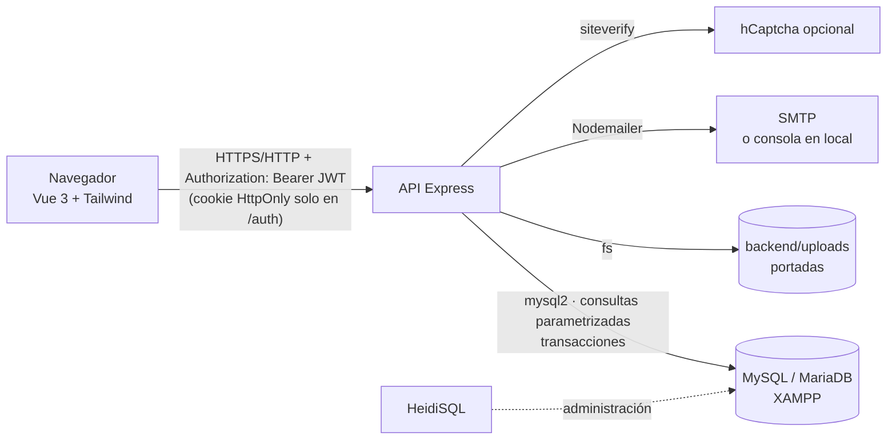
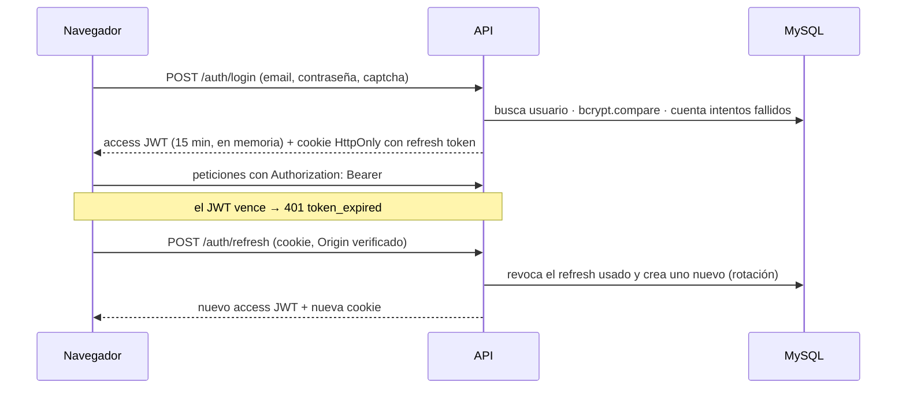
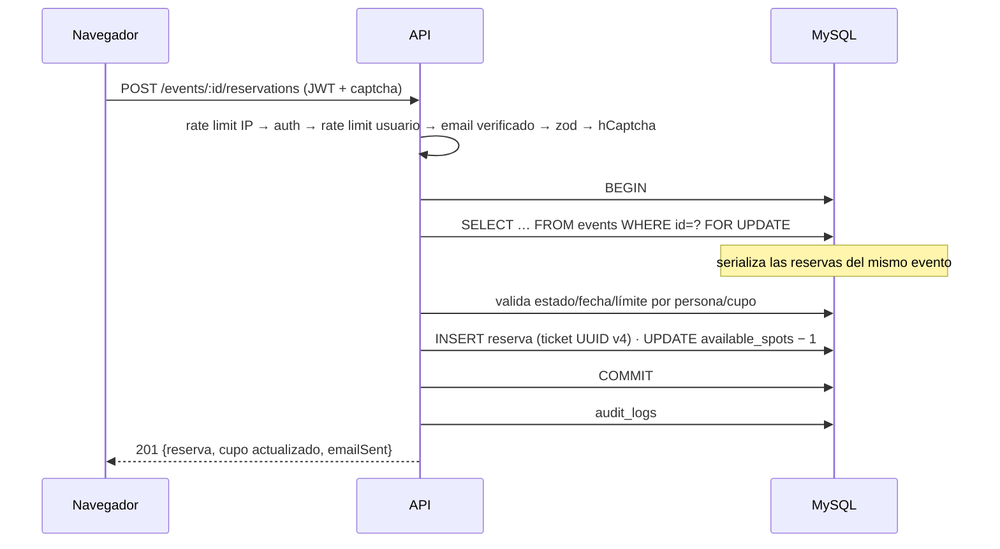
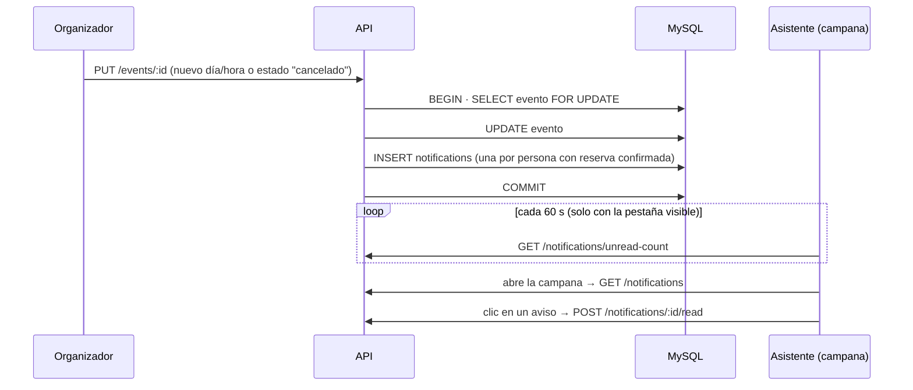

# Arquitectura

## Visión general



**Principio**: el navegador solo habla con la API. La API autentica (JWT), autoriza (rol + propiedad del recurso), valida el input y es la única que toca la base de datos.

## Capas del backend

```
Request → requestId → pino-http → Helmet → CORS → timeout → rate limit global → cookies → JSON (20 kB)
        → ruta: [rate limit específico] → requireAuth → requireRole → validate(zod) → controller → service → MySQL
        → notFound → errorHandler (respuesta genérica, detalle al log)
```

| Capa | Responsabilidad |
|---|---|
| `routes/` | Orden de middlewares por endpoint |
| `middlewares/` | auth, roles, rate limit, validación, captcha, origen confiable, errores, subida |
| `validators/` | Schemas zod (única fuente de verdad del input) |
| `controllers/` | Traducen HTTP ↔ servicios; sin lógica de negocio |
| `services/` | Reglas de negocio, autorización por objeto, SQL, transacciones, auditoría |
| `lib/db.js` | Pool MySQL, `query()` parametrizada y `withTransaction()` |
| `utils/` | logger, emails, tickets, hashing, URLs firmadas |

## Flujo: sesión



Al recargar la página, la app llama a `/auth/refresh`: si la cookie es válida, recupera la sesión sin guardar nada en `localStorage`.

## Flujo: reservar un lugar



## Flujo: check-in
Organizador → `PATCH /events/:id/attendees/:reservationId` o `POST /tickets/:code/check-in` → el servicio verifica que sea **dueño del evento o admin**, que la reserva pertenezca a ese evento, actualiza la asistencia y registra auditoría.

## Flujo: notificaciones de cambios en eventos



## Decisiones de diseño
- **Avisos en la misma transacción que el cambio**: si el cambio se revierte, no quedan avisos de algo que no ocurrió.
- **Cupo con un único punto de verdad**: `available_spots` solo se modifica dentro de transacciones con la fila del evento bloqueada.
- **Rol en base, no en el token**: el middleware lee `users.role` en cada request; un cambio de rol aplica de inmediato.
- **Guards del frontend**: solo UX; la seguridad real es del backend.
- **Imágenes fuera de una carpeta pública**: solo se entregan por URL firmada con vencimiento.
