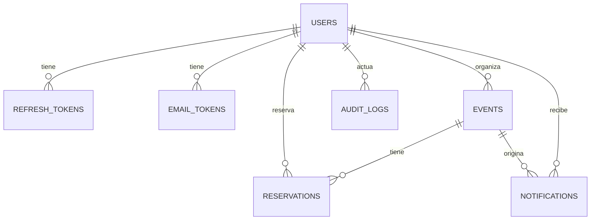

# Base de datos (MySQL / MariaDB)

Script único: `backend/sql/base_de_datos_mysql.sql` (ejecutar con HeidiSQL; es re-ejecutable). Compatible con MariaDB 10.4+ (XAMPP) y MySQL 8. Motor InnoDB, `utf8mb4`.

## Esquema


| Tabla | Campos clave |
|---|---|
| `users` | `id`, `email` (único), `dni` (único, 7–8 dígitos sin puntos; `NULL` solo en cuentas antiguas), `password_hash` (bcrypt), `full_name`, `phone`, `city`, `bio` (perfil editable), `role` (`attendee`/`organizer`/`admin`), `is_active`, `disabled_at`, `disabled_by`, `disabled_reason` (cuenta deshabilitada por un admin), `email_verified_at`, `failed_login_count`, `locked_until` |
| `notifications` | `user_id` (destinatario), `event_id` (`NULL` si el evento se eliminó), `type` (`event_cancelled`/`event_rescheduled`), `event_title` (copia del título), `old_starts_at`, `new_starts_at`, `read_at`, `created_at` |
| `refresh_tokens` | `user_id`, `token_hash` (sha256, único), `expires_at`, `revoked_at` |
| `email_tokens` | `user_id`, `token_hash` (sha256, único), `expires_at`, `used_at` |
| `events` | `organizer_id`, `title`, `description`, `category`, `starts_at` (UTC), `location`, `cover_file`, `capacity`, `available_spots`, `status` (`draft`/`published`/`cancelled`) |
| `reservations` | `event_id`, `user_id`, `ticket_code` (UUID v4 único), `booked_starts_at` (fecha del evento al reservar; permite marcar "Fecha modificada"), `status` (`confirmed`/`cancelled`), `attendance_status` (`pending`/`attended`/`no_show`), `checked_in_at`, `checked_in_by` |
| `audit_logs` | `actor_id`, `action`, `entity`, `entity_id`, `metadata`, `ip`, `created_at` |

Los identificadores son `CHAR(36)` (UUID v4 generados con `crypto.randomUUID()`). Las fechas se guardan en **UTC** (la conexión fija `time_zone = '+00:00'`) y el frontend las muestra en hora de Argentina.

## Integridad
- `CHECK (capacity BETWEEN 1 AND 5000)` y `CHECK (available_spots >= 0 AND available_spots <= capacity)`: la base rechaza un cupo inválido aunque la aplicación fallara.
- Claves foráneas con `ON DELETE CASCADE` (borrar un usuario o evento limpia sus dependencias) y `SET NULL` en actores de auditoría y check-in.
- `ticket_code` único; los tokens de sesión y de verificación se guardan **solo como hash**.
- Se usa `crypto.randomUUID()` y no `UUID()` de MySQL, porque éste genera UUID v1 (basado en hora y MAC), que es predecible.

## Transacciones (aforo)
Implementadas en `backend/src/services/reservationService.js` con `withTransaction()` (nivel `READ COMMITTED`):

1. `SELECT … FROM events WHERE id = ? FOR UPDATE` bloquea la fila del evento: las reservas del mismo evento se serializan.
2. Se validan estado, fecha, límite por persona y cupo con el bloqueo tomado.
3. `INSERT` del ticket y `UPDATE available_spots = available_spots - 1` en la misma transacción (`COMMIT` o `ROLLBACK` juntos).
4. El `CHECK` de la tabla es la red de seguridad final.

`cancelReservation` usa el mismo orden de bloqueo (evento → reserva) para evitar deadlocks. Editar el cupo de un evento (`updateEvent`) también bloquea la fila y recalcula `available_spots = capacidad − reservas confirmadas`, rechazando bajar de lo ya reservado.

## Privilegios
MySQL no tiene Row Level Security. Mitigaciones:
- Solo el backend se conecta a la base; **nunca** se expone el puerto 3306 a la red.
- Usuario `telon_app` con `SELECT, INSERT, UPDATE, DELETE` únicamente sobre `telon_eventos` (bloque opcional al final del script SQL): no puede borrar tablas ni cambiar la estructura.
- Toda autorización (rol y propiedad del recurso) se verifica en el backend antes de consultar.

## Migración desde una versión anterior
**v4 (DNI y fecha de reserva):** ejecutá `backend/sql/migracion_v4_dni_y_fecha_reserva.sql` (agrega `users.dni` con índice único y `reservations.booked_starts_at`, y completa esta última en las reservas existentes con la fecha actual del evento).

Si tu base ya existe, ejecutá `backend/sql/migracion_v3_perfil_notificaciones.sql` en HeidiSQL (agrega las columnas y la tabla nuevas sin tocar tus datos; usa `ADD COLUMN IF NOT EXISTS`, propio de MariaDB). Las cuentas existentes quedan habilitadas.

## Mantenimiento
Consultas de limpieza y derecho al olvido: ver README. Copias de seguridad: en HeidiSQL, **Herramientas → Exportar base de datos como SQL**; además copiá la carpeta `backend/uploads`.

```sql
-- Limpieza sugerida de notificaciones leídas con más de 90 días
DELETE FROM telon_eventos.notifications WHERE read_at IS NOT NULL AND created_at < UTC_TIMESTAMP() - INTERVAL 90 DAY;
```
